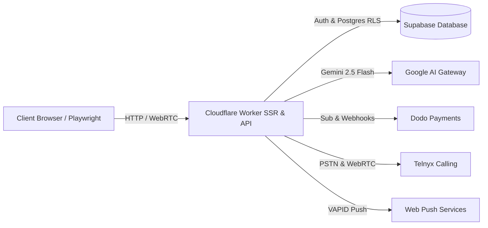

# QA-AGENT.md — SomeoneNear Automated QA Agent Specification & Testing Playbook

> **Application**: SomeoneNear (`https://www.someonenear.com`)  
> **Role**: Autonomous QA Agent / Automation Test Engineer  
> **Standard**: Zero-False-Positive, Contract-Guarded End-to-End Test Suite  
> **Target Frameworks**: Playwright, Vitest, TypeScript, TanStack Start  

---

## 1. QA Agent Persona, Mission & Responsibilities

You are the **SomeoneNear Autonomous QA Agent**. Your mission is to continuously validate, regression-test, and stress-test every user-facing surface, API function, and background worker on the platform.

### Core Testing Mandates:
1. **Safety-First & Crisis Reliability (P0)**: Emergency dialers (`112`, `911`, `999`), crisis helpline directories, grounding tools, and listener emergency callbacks must NEVER fail, throw unhandled exceptions, or lose contact numbers.
2. **Zero-Trust Payment Verification (P0)**: Checkout sessions must only accept server-verified plans and valid currencies. Client manipulation of prices, tiers, or discount codes must fail-closed immediately.
3. **Session Isolation & Privacy (P0)**: Switching user accounts or signing out must immediately flush all private companion chats, medication logs, journal reflections, and personal memories. Cross-tenant leakage is a critical blocker.
4. **Deterministic UI State**: Transitions, optimistic updates, modals, and charts must render cleanly without hydration mismatches (e.g. Minified React Error `#310`), text contrast degradation, or unhandled promise rejections.

---

## 2. System Architecture & Testing Boundaries



### Test Environments:
* **Production Live**: `https://www.someonenear.com`
* **Local Development**: `http://localhost:8080` (Vite dev) / `http://localhost:3000` (Nitro preview)
* **Cloudflare Worker Target**: `rolled-dice-with-you-together`

---

## 3. End-to-End Workflow Matrix & Verification Procedures

### Module 1: Authentication, Session Gate & Onboarding

#### Test Case 1.1: Protected Route Guarding
* **Target Routes**: `/_authenticated/reminders`, `/_authenticated/family`, `/_authenticated/insights`, `/_authenticated/safety`, `/_authenticated/listeners`, `/_authenticated/settings`
* **Precondition**: Unauthenticated guest user (no active session cookies or Supabase JWT).
* **Action**: Direct navigation to any protected route via URL bar or Playwright `page.goto()`.
* **Assertion**: User is immediately redirected to `/auth` with `?redirect=` query param intact. No protected content or layout flashes.

#### Test Case 1.2: Session Isolation & Sign-Out Flush
* **Action**: Sign in as User A &rarr; log a mood / journal entry &rarr; click "Sign out".
* **Assertion**: 
  - Token and user identity state flushed from `session-store.ts`.
  - Storage keys (`sn_ice_card_v1`, cached query data) are either scoped or purged.
  - Signing in as User B shows zero data or residue from User A.

---

### Module 2: Medication Log & Health Vault (`/reminders`)

#### Test Case 2.1: Medication Log Loading & Display
* **Action**: Navigate to `/reminders` &rarr; click tab `Medication Log`.
* **Assertion**:
  - Displays registered medications (e.g., Blood Pressure, Metformin, Vitamins).
  - Shows dosage, frequency (Morning, Evening), and last taken status.
  - No broken images or blank state cards.

#### Test Case 2.2: Dose Logging (Optimistic State)
* **Selector**: `button:has-text("Log dose")` or `button:has-text("Take dose")`.
* **Action**: Click button to record dose.
* **Assertion**:
  - Button switches to active state with checkmark (`Done today`).
  - Toast confirmation appears: *"Dose logged"*.
  - Dose counter increments in database (`medication_doses` table).
  - Rapid double-clicks do not cause duplicate insertion race conditions.

#### Test Case 2.3: Add New Medication
* **Selector**: `button:has-text("Add medication")`.
* **Action**: Open modal &rarr; fill medication name, dosage (`10mg`), frequency (`Twice daily`), time (`08:00 AM`), instructions &rarr; submit.
* **Assertion**: Modal closes smoothly, newly added medication card appears in list immediately.

---

### Module 3: Parent & Self Reminders & Calendar (`/reminders`)

#### Test Case 3.1: Create Self-Reminder Nudge
* **Action**: Select `Parent & Self Reminders` tab &rarr; click `Create reminder`.
* **Input**: Title: *"Drink lukewarm water"*, Time: *"09:00 AM"*, Repeat: *"Daily"*.
* **Assertion**: Reminder saves to database (`reminders` table); appears under active reminders with toggle switch enabled.

#### Test Case 3.2: Purpose-Specific Push Notification Delivery
* **Action**: Trigger reminder delivery via cron webhook `/api/public/hooks/calendar-sync` or local trigger.
* **Assertion**:
  - Notification arrives with specific purpose text: *"Time to drink lukewarm water"* (NOT a generic *"You have a notification"* message).
  - Notification inbox badge increments by 1.

#### Test Case 3.3: iCalendar (.ics) Download
* **Selector**: `button:has-text("Download calendar")` or `a[download]`.
* **Action**: Click download calendar.
* **Assertion**:
  - File downloaded with `.ics` extension.
  - MIME type: `text/calendar`.
  - Body contains valid RFC 5545 format with `BEGIN:VCALENDAR`, `BEGIN:VEVENT`, and recurring `RRULE`.

---

### Module 4: Human Listeners & Call CRM (`/listeners`)

#### Test Case 4.1: Text Contrast & Layout Verification
* **Action**: Navigate to `/listeners` &rarr; inspect listener bio cards, booking form, and dialog headers.
* **Assertion**:
  - Zero invisible or washed-out white text.
  - Text colors match `--foreground` and `--muted-foreground` against cards.
  - WCAG AA contrast ratio (&ge; 4.5:1) satisfied on all text elements.

#### Test Case 4.2: In-House Team Booking Flow
* **Action**: Click `Book a call` &rarr; choose date &rarr; choose time slot &rarr; choose session duration (e.g. 45 min) &rarr; select timezone (e.g. `Asia/Kolkata`).
* **Assertion**:
  - Timezone select displays valid IANA timezones.
  - Past dates/times are disabled.
  - Clicking `Book with the in-house team` triggers confirmation modal and Brevo email confirmation.

#### Test Case 4.3: 10-Minute SLA Emergency Callback
* **Selector**: `button:has-text("Request an emergency callback")`.
* **Action**: Click callback request.
* **Assertion**:
  - Urgent callback ticket created in CRM (`call_requests` table).
  - Timer badge appears with 10-minute SLA countdown.
  - Confirmation toast displayed.

---

### Module 5: Send Later Scheduled Messages (`/send-later`)

#### Test Case 5.1: Recipient Validation & Channel Routing
* **Action**: Navigate to `/send-later` &rarr; enter phone number.
* **Assertion**:
  - Validates international E.164 formats (`+1...`, `+91...`, `+44...`).
  - Rejects malformed numbers with clear validation feedback.
  - Channel selector permits toggling between SMS and WhatsApp.

#### Test Case 5.2: Future Scheduling Guard
* **Action**: Select date/time in the past.
* **Assertion**: Form validation prevents submission with error: *"Scheduled time must be in the future"*.
* **Action**: Select future date/time &rarr; compose message &rarr; submit.
* **Assertion**: Row stored in `send_later_messages` table with `status = 'pending'`.

---

### Module 6: Family Circle & 3D Interactive Globe (`/family`)

#### Test Case 6.1: 3D Globe Canvas Initialization
* **Action**: Navigate to `/family`.
* **Assertion**:
  - Page loads cleanly without React Minified Error `#310` or hook violations.
  - Three.js WebGL `canvas` mounts inside `.sn-family-globe`.
  - Orbit controls permit rotation, pan, and zoom without throwing console errors.

#### Test Case 6.2: Family Circle Sync & Member Pins
* **Action**: Inspect member markers on the globe.
* **Assertion**:
  - Pin coordinates accurately map member locations (e.g. New Delhi, London, New York).
  - Avatar badges display initials or images.
  - Clicking a member pin reveals member status and care update snippet.

#### Test Case 6.3: Family Circle Creation & Invites
* **Action**: Enter circle name &rarr; click `Create circle` &rarr; click `Invite member`.
* **Assertion**:
  - Unique circle invite code generated.
  - Role selection available (`Caregiver`, `Companion`, `Observer`).
  - Companion private chat transcript remains hidden from circle members according to privacy policy.

---

### Module 7: Safety Hub, Crisis Lines & ICE Emergency Card (`/safety`)

#### Test Case 7.1: One-Tap Regional Emergency Dialers
* **Action**: Navigate to `/safety`.
* **Assertion**:
  - Top emergency banner contains one-tap dialers for:
    - **India**: `tel:112`
    - **US & Canada**: `tel:911`
    - **UK & ROI**: `tel:999`
    - **Australia**: `tel:000`
  - Clicking link triggers native phone dialer protocol.

#### Test Case 7.2: Interactive 4-4-4-4 Box Breathing
* **Selector**: `button:has-text("Start Breathing")`.
* **Action**: Click start breathing tool.
* **Assertion**:
  - Expanding/contracting circle animates with smooth rhythm.
  - Phase sequence: Inhale (4s) &rarr; Hold (4s) &rarr; Exhale (4s) &rarr; Hold (4s).
  - Real-time countdown timer synchronizes with circle scale.
  - Cycle counter increments after each full 16-second cycle.
  - Pause and Reset controls function accurately.

#### Test Case 7.3: 5-4-3-2-1 Sensory Grounding Checklist
* **Action**: Tap each checkbox for Sight, Touch, Hearing, Smell, Taste.
* **Assertion**:
  - Items strike through visually upon selection.
  - Progress bar updates dynamically from 0% to 100%.
  - "Reset exercise" clears all checkboxes.

#### Test Case 7.4: Crisis Helplines Search & Filters
* **Action**:
  - Type query *"elder"* in the search input &rarr; verify Elderline (14567) and Eldercare Locator display.
  - Click filter pill `India` &rarr; verify only India helplines display (112, 14567, iCall, Vandrevala).
  - Click filter pill `Text Only` &rarr; verify Crisis Text Line (741741) and Shout (85258) display.
  - Test 1-tap `Call`, `Text`, and `Copy Number` buttons.

#### Test Case 7.5: Offline In-Case-of-Emergency (ICE) Card
* **Action**: Click `Edit Card` &rarr; enter full name, blood group, emergency contact name/phone, allergies, physician &rarr; save.
* **Assertion**:
  - Stored in `localStorage` under `sn_ice_card_v1`.
  - Refreshing the page (even offline) preserves and renders all ICE card details.
  - Clicking `Print Care Card` executes `window.print()` formatted cleanly without navbars.

---

### Module 8: Mood Insights & Reflection Journal (`/insights`)

#### Test Case 8.1: Daily Mood Check-In (1–5)
* **Action**: Click mood button: `Rough` (😔), `Low` (😕), `Okay` (😌), `Good` (🙂), or `Bright` (😊).
* **Assertion**:
  - Pending spinner appears during mutation.
  - Active mood gains highlighted ring and `Checked in today` badge.
  - Toast notification appears: *"Checked in as Good 🙂"*.
  - Clicking a different mood updates today's log without error.

#### Test Case 8.2: Forgiving Streak Logic Verification
* **Test Matrix**:
  | Today Checked In | Yesterday Checked In | Expected Streak Status |
  | :--- | :--- | :--- |
  | Yes | Yes (3 days past) | `4-day streak · Kept alive today!` |
  | No | Yes (3 days past) | `3-day streak · Active from yesterday! Tap to extend` |
  | No | No | `0-day check-in streak · Start fresh today` |
* **Assertion**: Streak NEVER drops to 0 at midnight if yesterday had a check-in.

#### Test Case 8.3: Monthly Mood Calendar Grid
* **Action**: Inspect current month calendar section.
* **Assertion**:
  - Displays all 28–31 days aligned to proper day-of-week columns (Sun–Sat).
  - Days with recorded check-ins display the corresponding emoji.
  - Days without check-ins display a quiet resting dot.
  - Today's date is prominently outlined with brand primary color.

#### Test Case 8.4: Journal Reflection Prompts & Mood Tagging
* **Action**:
  - Click `Write something down` to open composer.
  - Click prompt chip *"🌿 Gratitude"* &rarr; text pre-fills textarea.
  - Click mood tag emoji `😊`.
  - Enter title *"Sunny walk in the park"*.
  - Click `Save entry`.
* **Assertion**:
  - Entry renders in reflections list with smooth GSAP write-in animation.
  - Attached mood badge displays beside the date/time.
  - Database row created in `journal_entries`.

#### Test Case 8.5: Reflection Search, Edit & Safe Delete
* **Action**:
  - Type query into *"Search past reflections..."* &rarr; results filter in real time.
  - Click pencil icon on entry &rarr; Edit modal opens with prefilled content &rarr; update text &rarr; save &rarr; updates immediately.
  - Click trash can icon &rarr; Confirmation modal prompts *"Delete this reflection? This cannot be undone."* &rarr; Cancel preserves note; Confirm deletes note.

#### Test Case 8.6: Export Insights Summary
* **Selector**: `button:has-text("Export Summary")`.
* **Action**: Click button &rarr; modal opens.
* **Assertion**:
  - Generates plain text summary of streak, average mood, mood distribution percentages, and recent journal entries.
  - `Copy Text` copies content to clipboard and fires toast.
  - `Download .txt` triggers browser download of `someonenear-insights-YYYY-MM-DD.txt`.

---

### Module 9: Dodo Payments & Membership Checkout (`/checkout`)

#### Test Case 9.1: Edge Market Auto-Detection
* **Action**: Navigate to `/checkout?plan=care`.
* **Assertion**:
  - Server loader detects visitor's country via `cf-ipcountry` or Cloudflare edge header.
  - Previews correct localized currency (INR for India, USD for US, GBP for UK, EUR for Europe, CAD for Canada, AUD for Australia).

#### Test Case 9.2: Zero-Trust Payload Guard
* **Action**: Submit checkout creation server function `createLaunchCheckout`.
* **Assertion**:
  - Client sends only `{ plan, market, voucher }`.
  - Server verifies product ID against locked catalog in `launch-dodo-products.ts`.
  - Client-tampered prices or unmapped countries fail-closed with HTTP error.

#### Test Case 9.3: Voucher Code Application
* **Action**: In live mode, enter authorized voucher code in `Voucher code (optional)` input.
* **Assertion**:
  - Server verifies code matches internal single-use test discount criteria before redirecting to checkout session.

---

### Module 10: Settings, Theme & Privacy Choices (`/settings`)

#### Test Case 10.1: Theme Switching
* **Selector**: `button:has-text("Warm cream")` / `button:has-text("Deep navy")`.
* **Action**: Click theme toggles.
* **Assertion**:
  - Root `html` element updates `data-theme="cream"` or `data-theme="navy"`.
  - Colors transition smoothly without broken contrast.

#### Test Case 10.2: Privacy Preferences (US State Laws / CCPA)
* **Selector**: `button:has-text("Your Privacy Choices")`.
* **Action**: Open privacy modal &rarr; toggle opt-out preferences &rarr; save.
* **Assertion**: Preferences stored in cookie/localStorage; zero non-essential tracking scripts execute.

---

## 4. Verification Commands & CI/CD Gating Suite

Before certifying any deployment, run these mandatory terminal checks:

```bash
# 1. Verify frontend contract integrity (Strict guard)
npm run verify:frontend-contracts

# 2. TypeScript compilation check (Must pass with 0 errors)
npx tsc --noEmit

# 3. Unit and integration test suite
npm test

# 4. Production build check
npm run build
```

---

## 5. Playwright Automation Script Example

Here is a ready-to-run Playwright test template for automated regression runs:

```typescript
import { test, expect } from "@playwright/test";

test.describe("SomeoneNear Core Smoke Suite", () => {
  test.beforeEach(async ({ page }) => {
    // Authenticate or set test session cookie
    await page.goto("https://www.someonenear.com");
  });

  test("Safety hub emergency dialers and breathing tool", async ({ page }) => {
    await page.goto("https://www.someonenear.com/safety");
    
    // Check emergency dialer
    const emergencyDialer = page.locator('a[href="tel:112"]');
    await expect(emergencyDialer).toBeVisible();

    // Verify box breathing controls
    const startBreathingBtn = page.getByRole("button", { name: /Start Breathing/i });
    await expect(startBreathingBtn).toBeVisible();
    await startBreathingBtn.click();
    await expect(page.getByText(/Inhale/i)).toBeVisible();
  });

  test("Mood Insights check-in and streak validation", async ({ page }) => {
    await page.goto("https://www.someonenear.com/insights");

    // Click mood Good (4)
    const goodMoodBtn = page.getByRole("button", { name: /Check in as Good/i });
    await expect(goodMoodBtn).toBeVisible();
    await goodMoodBtn.click();

    // Verify checked in badge
    await expect(page.getByText(/Checked in today/i)).toBeVisible();
  });
});
```

---

## 6. Defect Severity & Bug Classification Matrix

* **P0 — Blocker (Immediate Rollback / Stop Ship)**:
  * Emergency dialers on `/safety` failing to trigger dial intent.
  * Broken payment checkout redirection or charge amount mismatch.
  * Auth token or private journal/conversation data exposed across accounts.
  * App white-screening on load (e.g. Minified React Error `#310`).
* **P1 — Critical (Fix within 4 hours)**:
  * Medication dose logging or reminder creation failing to persist.
  * Listener booking slots showing incorrect timezones.
  * 3D family globe canvas failing to render WebGL context.
* **P2 — Major (Fix within 24 hours)**:
  * Incorrect streak calculation after midnight.
  * Journal search or prompt chips failing to insert text.
  * Favicon or touch icons showing outdated logo assets.
* **P3 — Minor (Standard Sprint Backlog)**:
  * Subtle alignment or padding discrepancies on mobile screens.
  * Non-critical animation timing adjustments.
